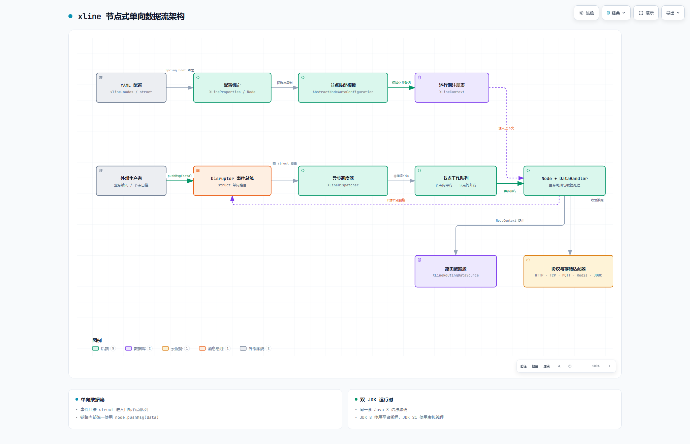

# xline

节点式拓扑数据流框架：数据按 `xline.struct` 定义的拓扑**单向传递**（上一层推给下一层），
各节点按配置条件化初始化；同时支持 **JDK 1.8**（SpringBoot 2.7）与 **JDK 21**（SpringBoot 4.1），
由 Maven profile 按运行 JDK 自动切换。



交互版：[doc/xline-architecture.html](doc/xline-architecture.html)（支持暗/亮主题）

## 模块

| 模块 | 说明 |
| --- | --- |
| `xline-core` | 节点模型、struct 拓扑、事件总线、数据处理契约、配置载体、基础依赖 |
| `xline-db-support` | 关系型数据库节点共用的 Druid、AnyLine 与 Flyway 支撑 |
| `xline-db-mysql` | MySQL 节点 |
| `xline-db-postgresql` | PostgreSQL 节点 |
| `xline-db-sqlite` | SQLite 节点 |
| `xline-db-sqlserver-msssql` | SQL Server 节点（mssql-jdbc 驱动） |
| `xline-db-sqlserver-jtds` | SQL Server 节点（jTDS 驱动） |
| `xline-tcp` | TCP 节点（JDK socket） |
| `xline-http` | HTTP 节点（Forest） |
| `xline-serial-port` | 串口节点（jSerialComm，232 / 485） |
| `xline-mqtt` | MQTT v5 节点（Paho，订阅与发布） |
| `xline-redis` | Redis 节点（Redisson，内联或外部 YAML 配置） |
| `xline-db-h2` | H2 节点（Druid、AnyLine、可选 Flyway） |
| `xline-db-duckdb` | DuckDB 节点（独立 JDBC 连接） |
| `xline-app` | 轻量启动应用，用于装配节点并运行数据流（非 Web 应用） |

**不引入某个节点模块，对应类型的节点就永远不会被初始化**；SQL Server 的两个驱动模块二选一引入。

## 构建与运行

```bash
mvn clean install -DskipTests                    # 按当前 JDK 自动选分支
mvn -P '!jdk21,jdk8' clean install -DskipTests   # 强制 jdk8 分支（两个 profile 互斥）
java -jar target/xline.jar     # 启动非 Web 应用
```

运行包固定输出到**工程根目录**的 `target/xline.jar`（`xline-app` 的构建目录被覆写，模块自身不再生成 `target`），
文件名不带版本号；其余模块仍各自输出到模块目录下的 `target`。

启动日志示例：

```
【DataSource - SQLite】reg success: local
Started XlineApp in 2.3 seconds
```

## 测试配置（demo）

`xline-app` 自带的 `application.yml` 只有框架级配置，不含任何节点；
节点与 `struct` 的测试配置统一放在工程根目录的 `demo/` 下，启动时叠加（附加位置优先级更高，会整段覆盖 `xline.nodes`）：

```bash
java -jar target/xline.jar --spring.config.additional-location=file:./demo/tcp-test.yml
```

| 文件 | 内容 |
| --- | --- |
| `demo/tcp-test.yml` | `node1`（server 9847）与 `node2`（client 127.0.0.1:8888）按 `0x0A0B0C0D` 帧头双向转发 |
| `demo/serial-test.yml` | `c2`（COM2）与 `c3`（COM3）双向互传 |
| `demo/db-test.yml` | `db1`（SQL Server）与 `api`（HTTP 节点） |
| `demo/mqtt-test.yml` | MQTT v5 订阅、发布与遗嘱；需 broker，转发由处理器实现 |
| `demo/redis-test.yml` | Redis 认证、连接池与超时；需 Redis 服务 |
| `demo/h2-test.yml` | H2 内存库、连接池与仅声明类型的节点 |
| `demo/duckdb-test.yml` | DuckDB 独立内存库与驱动参数 |

## 快速开始

```yaml
xline:
  nodes:
    - name: local
      sqlite:                 # 书写哪个配置段，节点类型即推断为该类型
        db-path: ":memory:"
    - name: archive
      sqlite:
        db-path: ":memory:"
  struct:                     # key 为上游节点，value 为下游节点列表
    local:
      - archive
```

```java
@Component("archive")          // Bean 名与节点名一致
public class ArchiveHandler implements SqliteDataHandler {
    @Override public void init(SqliteNode node) { }
    @Override public void rec(SqliteNode node, Object data) { }   // 收到上游数据
    @Override public void destroy(SqliteNode node) { }
}
```

推送：业务处理器拿到的就是节点自身，直接 `node.pushMsg(data)` 即以本节点为出发节点投递
（`pushMsg` 是 `INode` 契约方法，出发节点名由节点自己提供，**不需要传节点名**）→
事件总线解析 `struct` → `archive.receiveData(data)`。
`XLineContext.pushMsg(节点名, data)` 是按名注入事件总线的底层路由 API，业务代码不要直接用。
容器中有多个处理器实现时按 Bean 名与节点名匹配，只有一个实现时所有节点共用。

## 优雅停机

`server.shutdown: graceful` 下，收到停止信号（Ctrl+C / systemd / 服务停止）时按序完成：

1. 等待在途 Web 请求完成；
2. `ContextClosedEvent` 统一销毁节点：先回调处理器 `destroy`，再释放自身连接池、DuckDB 连接、MQTT/Redis 客户端、TCP 与串口资源；
3. Spring 销毁剩余 Bean（含事件总线 Disruptor 的关闭），之后 JVM 退出（Ctrl+C 停机退出码 130）。

大规模资源下销毁按「分组并行」执行：共享同一业务处理器的节点串行销毁（处理器实现可能非线程安全），其余节点并行，并行度取节点组数与 CPU 数的较小值；TCP server 节点的几十万客户端连接也是并行关闭。总时限 30 秒：单个节点销毁卡死不会无限期拖住停机，超时后中断并告警，剩余资源由操作系统回收。

节点不是 Spring Bean，Spring 的销毁回调够不到它们 —— 没有该监听器时，
节点资源（连接池、socket、串口）只能靠进程死亡由操作系统回收，对端会看到连接骤断而非优雅关闭。

## 数据库节点

MySQL / PostgreSQL / SQL Server 最少只需 `database-name`（或 `jdbc-url`）与账号，其余均有默认值：

```yaml
- name: db
  mysql:
    database-name: test        # 未配置 jdbc-url 时必填
    username: root
    password: root
    # 以下均可省略
    host: 127.0.0.1            # 默认 127.0.0.1
    port: 3306                 # 默认该库标准端口
    jdbc-url:                  # 配置后忽略按字段拼装
    driver-class-name:         # 默认该库驱动
    use-ssl: false             # 仅 MySQL，默认 false
    server-timezone: GMT+8     # 仅 MySQL，默认 GMT+8
    connection-properties:     # 额外驱动属性，原样传给驱动
      connectTimeout: "5000"
    pool:                      # Druid 连接池，以下为默认值
      initial-size: 5
      min-idle: 5
      max-active: 10
      max-wait-millis: 60000
      validation-query: select 1
      validation-query-timeout-seconds: 3
      test-on-borrow: false
      test-on-return: false
      test-while-idle: true
      time-between-eviction-runs-millis: 60000
      min-evictable-idle-time-millis: 300000
      time-between-connect-error-millis: 5000   # 建连失败后的重试间隔，失败时持续重试
    flyway: false              # 默认关闭
    baseline-on-migrate: true
    flyway-locations:          # 默认 classpath:<数据库类型>/<节点名>
```

PostgreSQL 额外支持 `schema`（拼为 `currentSchema`）。SQLite 支持除 `host` / `port` / `database-name` / 账号外的同名项；
SQLite 配置段整体可省略（只写 `type: sqlite`），默认库文件 `xline.db`。

| 数据库 | 默认端口 | 配置段 | 业务契约 |
| --- | --- | --- | --- |
| MySQL | 3306 | `mysql` | `MysqlDataHandler` |
| PostgreSQL | 5432 | `postgresql` | `PostgresDataHandler` |
| SQLite | — | `sqlite`（字段 `db-path`，支持 `:memory:`） | `SqliteDataHandler` |
| SQL Server（mssql-jdbc） | 1433 | `mssql` | `MssqlDataHandler` |
| SQL Server（jTDS） | 1433 | `mssql` | `JtdsDataHandler` |
| H2 | — | `h2` | `H2DataHandler` |
| DuckDB | — | `duckdb` | `DuckdbDataHandler` |

SQL Server 额外支持 `instance`（实例名）、`domain`（域认证）、`encrypt`、`trust-server-certificate`。
两个驱动模块的差异仅在 URL 拼接：

| 模块 | URL 形态 |
| --- | --- |
| `xline-db-sqlserver-msssql` | `jdbc:sqlserver://host:1433;databaseName=db;encrypt=false;...` |
| `xline-db-sqlserver-jtds` | `jdbc:jtds:sqlserver://host:1433/db` |

除 DuckDB 外，数据库节点的数据源对外有两种用法：

- **anyline**：`ServiceProxy.service(节点名)` 直接取服务；
- **MyBatis-Plus**：注入容器中的路由 `DataSource`，用 `NodeContext.use("节点名")` 指定节点（用完 `clear()`，未指定时路由到首个就绪节点）。

### H2 / DuckDB

- **H2**：默认内存库，以节点名作为库名；`mode: file` 配合 `db-path` 使用文件库，`jdbc-url` 优先。`pool.*` 配置连接池，`flyway` 开启迁移，`flyway-locations` 可覆盖默认脚本目录；也可用 `node.dataSource()`。
- **DuckDB**：默认独立内存库；`db-path` 指定文件，`jdbc-url` 优先，`read-only` 控制只读，`connection-properties` 透传驱动参数。用 `node.connection()` 访问，不接入 AnyLine、路由数据源或 Flyway；连接由节点关闭。

## MQTT 节点

仅支持 MQTT v5。配置 `broker`、`client-id`（默认节点名）、`username/password`、`subscriptions`（主题与 QoS）、`publish-topic/publish-qos`；心跳、超时、自动重连、会话有效期和 `will` 见 [示例](demo/mqtt-test.yml)。

- 收到消息自动以 `MqttEnvelope`（主题、字节载荷、QoS、保留/重复标记）推向下游。
- 上游数据交给 `MqttDataHandler.rec`，由业务调用 `node.publish(data)` 或 `node.publish(topic, data)`；返回异步 token，不默认自动发布。
- 重连后恢复订阅，每个节点独立持有和关闭客户端。

## Redis 节点

业务实现 `RedisDataHandler`，通过 `node.client()` 使用 Redisson，默认 `StringCodec`。支持两种配置，二选一：

1. **内联**：`redis.address`、`username/password`、`database`、超时与连接池，见 [示例](demo/redis-test.yml)。
2. **外部原生 YAML**：`config-location` 支持 `classpath:`（含 JAR 内资源）或 `file:`，替代内联连接配置，可配置集群、哨兵和自定义 codec；关闭时限仍取节点配置。

```yaml
# xline.nodes 中的节点
- name: cache
  redis:
    config-location: classpath:redis/cache.yml
```

```yaml
# redis/cache.yml：认证位于顶层；先设置环境变量 REDIS_PASSWORD
username: default
password: ${REDIS_PASSWORD}
singleServerConfig:
  address: redis://127.0.0.1:6379
  database: 0
```

内联配置由 Spring Boot `@ConfigurationProperties` 绑定；外部文件由 `Config.fromYAML` 解析。两分支共用 Redisson 4.8，根 POM 固定 SnakeYAML 2.7，避免 Boot 2 默认版本不兼容。

## TCP 节点

```yaml
- name: device
  tcp:
    mode: server          # server 监听 / client 连接，默认 server
    port: 10011           # 必填：server 监听端口，client 对端端口
    host: 127.0.0.1       # client 必填；server 为绑定地址，留空绑定全部
    charset: UTF-8
    append-new-line: true # 发送时追加换行（仅按行收发需要）
    read-timeout-millis: 0 # 读取超时：0 不启用；自定义帧解码器用它做「空闲即出帧」
    reconnect: true       # client 断线重连
    reconnect-interval-millis: 3000
    connect-timeout-millis: 5000 # client 建连超时，0 不限时
    backlog: 50           # server 等待接入队列长度
    keep-alive: false     # TCP keep-alive 探测
    tcp-no-delay: false   # 关闭 Nagle，小包立即发送
    buffer-size: 1024     # 接收缓冲（字节）
    max-frame-length: 65536  # 默认按行分帧的单帧上限，攒满即出帧
    max-connections: 0    # server 最大在线连接数，0 不限制
    write-timeout-millis: 10000 # 单次写出超时，超时断开该连接；0 不限时
```

- **对端 → 下游**：按帧解码器解出一帧（`byte[]`），以本节点为源头推给下游；
- **上游 → 对端**：在 `TcpDataHandler.rec` 中调用 `node.send(data)`（server 模式广播给全部在线连接）；
  `byte[]` 原样写出，其余按 `charset` 转文本 —— 转发二进制帧时无需任何转换。

### 帧解码器

默认按行分帧（读到 `\n` 为一帧）。二进制协议实现 `TcpFrameDecoder` 并注册为 Bean 即可替换，
按 Bean 名与节点名匹配，只有一个实现时全部节点共用：

```java
@Component
public class HeaderFrameDecoder implements TcpFrameDecoder {
    @Override
    public byte[] decode(PushbackInputStream in) throws IOException {
        // 返回一帧字节；返回 null 表示对端关闭；可 unread 最多 PUSHBACK_SIZE 字节留给下一帧
    }
}
```

实例在所有连接间共享，**实现必须无状态**；读取超时（`read-timeout-millis`）可在解码器内部消化，
用于「空闲即出帧」，否则不足一帧的数据要等到连接关闭才吐出。

`demo/tcp-test.yml` 与 `com.csf.xline.app.codec.HeaderFrameDecoder` 是一个完整例子：
`0x0A0B0C0D` 起始、整帧最长 100 字节，靠「下一个帧头 / 收满 100 字节 / 空闲」三种条件结束一帧。

## HTTP 节点

请求由 Forest 实现；**`http` 配置段整体可选**，未配置的项沿用 `forest.*` 全局配置。

只写 `type: http`、不写 `http` 段即可 —— 此时地址由业务接口自带的 `@Address` / `@Request(url)` 决定：

```yaml
xline:
  nodes:
    - name: api
      type: http              # 不需要任何 http 属性
```

需要节点级地址或覆盖全局超时时才写 `http` 段（写了则以节点值优先）：

```yaml
forest:
  connect-timeout: 3000
  max-connections: 1000

xline:
  nodes:
    - name: api
      type: http
      http:
        base-url: http://192.168.1.10:8080
        read-timeout: 8888     # 覆盖全局的 read-timeout
```

```java
public interface UserApi {
    @Request(url = "/user/list", type = "GET")
    String list();
}

// 处理器内
String result = node.client(UserApi.class).list();   // 绑定本节点配置
String url = node.url("/user/list");                 // 拼接 base-url + path，未配置 http 段时报错提示
```

响应非 2xx 时 Forest 抛 `ForestNetworkException`，可在接口上用 `@SuccessWhen` 自定义成功条件。

## 串口节点

串口既是数据源头（读到字节推向下游），也是数据出口（把上游数据写入串口）。

```yaml
xline:
  nodes:
    - name: c1
      serial-port:
        device: COM1                # Windows 为 COM1，Linux / macOS 为 /dev/ttyS0
        baud-rate: 9600             # 默认 115200
        data-bits: 8                # 默认 8
        stop-bits: 1                # 默认 1
        parity: 0                   # 0 无 / 1 奇 / 2 偶 / 3 MARK / 4 SPACE，默认 0
        use-rs485-mode: false       # 默认 false
        flow-control: 0             # 流控位掩码：0 关闭 / 1 RTS / 16 CTS / 256 DSR / 4096 DTR / 65536 XON-XOFF 入 / 1048576 XON-XOFF 出
        reconnect: true             # 打开失败或串口拔出后自动重开，默认 true
        reconnect-interval-millis: 3000
        charset: UTF-8              # 上游推送文本数据时按此编码写出
    - name: c2
      serial-port:
        device: COM2
  struct:
    c1:                             # 两个方向各配一条边，即成对串口双向转发
      - c2
    c2:
      - c1
```

- **串口 → 下游**：读到字节即以本节点为源头推给下游（数据为 `byte[]`）；
- **上游 → 串口**：有业务处理器时由 `SerialPortDataHandler.rec` 决定；
  **未注册处理器时节点自动把原始字节写入串口** —— 成对串口无需任何业务代码即可双向转发；
- 收发原始数据统一以**大写十六进制**记录（`01AB0C`），避免非 ASCII 字节打印成乱码。

串口不存在、被占用或被拔掉时不阻断启动：记录告警后由后台线程按 `reconnect` 重开。
需要参与业务时注册处理器（Bean 名与节点名一致即可按名匹配）：

```java
@Component("c1")
public class C1Handler implements SerialPortDataHandler {
    @Override public void init(SerialPortNode node) { }
    @Override public void rec(SerialPortNode node, Object data) { node.send(data); }   // 转发到串口
    @Override public void destroy(SerialPortNode node) { }
}
```

## 配置项一览

| 配置 | 说明 |
| --- | --- |
| `xline.nodes[].name` | 节点名，用于 `struct`、处理器匹配与数据源注册 |
| `xline.nodes[].type` | 节点类型（可选）：书写类型配置段时自动推断；`http` / `mqtt` / `redis` / `h2` / `duckdb` 支持仅声明类型 |
| `xline.nodes[].<类型段>` | `mysql` / `postgresql` / `sqlite` / `mssql` / `tcp` / `http` / `serial-port` / `mqtt` / `redis` / `h2` / `duckdb`，一个节点只选一种 |
| `xline.nodes[].extra` | 业务扩展配置 |
| `xline.struct` | 单向拓扑：key 上游，value 下游列表 |
| `xline.bus.buffer-size` | 事件总线环形缓冲大小，默认 1024（向上取 2 的幂） |
| `xline.bus.worker-threads` | 节点处理线程数，仅 JDK 8 分支生效，默认 CPU × 2（至少 4）；JDK 21 分支用虚拟线程 |
| `xline.bus.node-queue-capacity` | 单节点待处理上限，默认 10000：达到后外部生产者等待（不丢数据），处理器内推送超过 2 倍时丢弃并告警 |
| `forest.*` | Forest 全局配置（引入 `xline-http` 时生效） |
| `spring.flyway.enabled` | 必须为 `false`：迁移由节点按 `flyway` 开关执行 |

### 消息处理模型

`node.pushMsg` → 环形缓冲 → 总线消费线程（只路由）→ 各下游节点的待处理队列 → 工作线程池执行 `DataHandler.rec`。

- 同一节点的数据按到达顺序串行处理，同一节点不会被并发调用；不同节点并行，互不保证顺序；
- 多个节点共用同一处理器实例时，该实例会被并发调用，须自行保证线程安全；
- 慢节点只拖慢自己；处理器里再 `pushMsg` 不会与总线互相等待。

开发约定、扩展步骤与双分支机制见 [AGENTS.md](AGENTS.md)。
